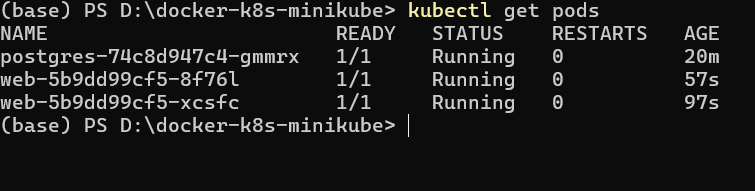
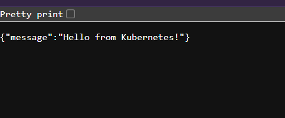
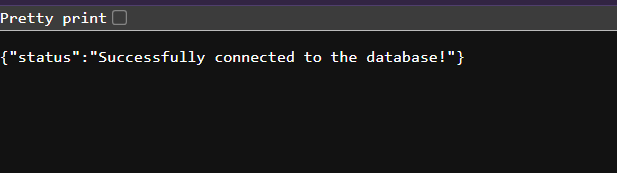
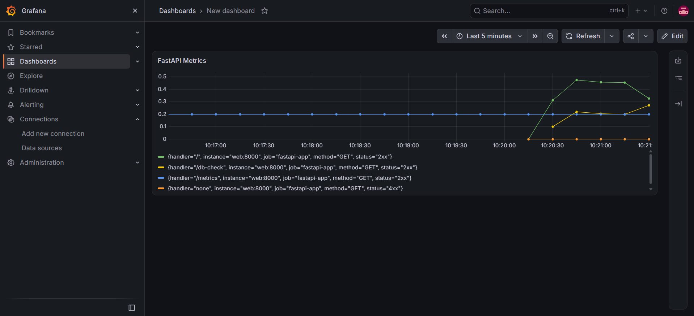

# Docker & Kubernetes (Minikube) Project

This repository demonstrates containerizing a Python (FastAPI) application and deploying it alongside a PostgreSQL database using Docker Compose and Kubernetes.

## Architecture
- **Web App:** FastAPI app serving HTTP endpoints.
- **Database:** PostgreSQL 15.
- **Docker Compose:** For local development and testing.
- **Kubernetes (Minikube):** For production-like orchestration, featuring 2 replicas of the web app for high availability.

## Prerequisites
- Docker and Docker Compose installed.
- Minikube and kubectl installed.

## Local Development (Docker Compose)
1. Run `docker compose up --build`
2. Access the app at `http://localhost:8000`
3. Test DB connection at `http://localhost:8000/db-check`

## Kubernetes Deployment
1. Start Minikube: `minikube start`
2. Apply manifests:
   `kubectl apply -f k8s/db.yaml`
   `kubectl apply -f k8s/web.yaml`
3. Access the service:
   `minikube service web`

## Proof of Deployment

### Kubernetes Pods (Minikube)
*Both web replicas and the database are running successfully.*

### Web App Output

### Database Connection Test
*The web app successfully communicates with the PostgreSQL database.*

## Monitoring & Observability (Prometheus & Grafana)

This project includes a full observability stack:
- **Prometheus** scrapes the FastAPI `/metrics` endpoint every 5 seconds.
- **Grafana** visualizes the metrics, allowing us to monitor SLIs (Service Level Indicators) such as request rate, error rate, and latency.

### How to access:
- Prometheus: `http://localhost:9090`
- Grafana: `http://localhost:3001` (Login: admin/admin)

## What I Learned
- Writing multi-stage Dockerfiles for Python applications.
- Orchestrating multi-container apps with Docker Compose.
- Creating Kubernetes Deployments and Services (ClusterIP for DB, NodePort for Web).
- Scaling applications using Kubernetes Replicas.
- Publishing Docker images to Docker Hub and pulling them into a Kubernetes cluster.